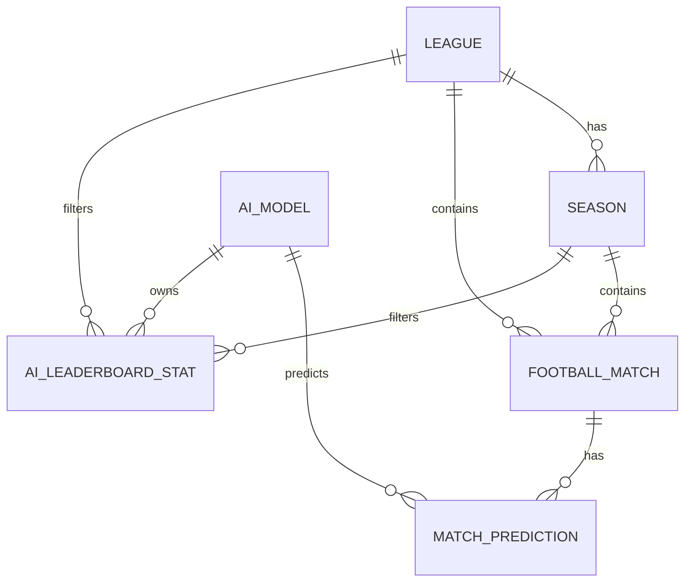
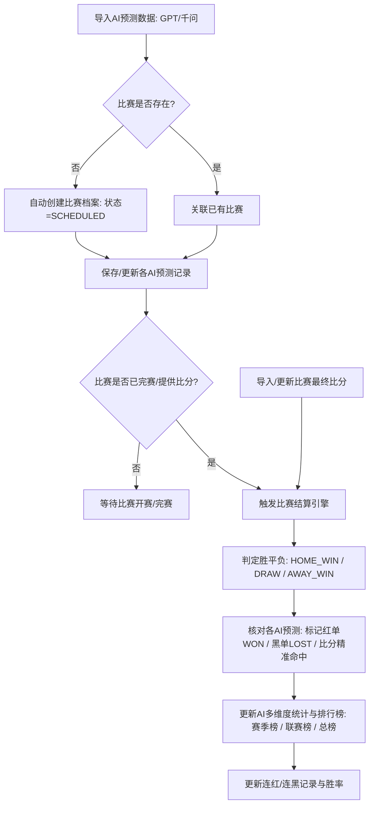

# 足球比赛AI预测导入与胜率排行榜服务端实现方案

## 需求背景与目标

本项目为 **winnerLogBackend** 服务端系统，核心业务是：
1. **预测建档与导入**：从 GPT 和通义千问（Qwen）等 AI 获取足球比赛预测（胜平负、预测比分、置信度、推荐理由等）。未开赛的比赛进行建档与预测关联；已完赛比赛导入时直接结算。
2. **比赛结果结算与AI胜率统计**：比赛结束后导入真实比分与赛果（主胜/平/客胜），自动对各 AI 模型的预测进行红黑单结算、比分精确命中判定，并自动计算连红/连黑状态。
3. **联赛与赛季分类体系**：主打五大联赛（英超、西甲、意甲、德甲、法甲）、欧洲冠军联赛（欧冠）、世界杯、欧洲杯等赛事，按联赛与赛季（如 2024-2025 赛季、2026 世界杯）清晰区分。
4. **多维度排行榜（Leaderboard）**：根据最新结算结果实时更新赛季排行榜、联赛排行榜、全局总榜，支持 GPT vs 千问 对比分析与胜率走势。
5. **完整交付物**：提供完整的后端代码实现（Spring Boot 3 + Java 17 + Spring Data JPA + Swagger）以及标准高可用的 MySQL DDL 建表语句与预置基础数据。

---

## 数据库架构设计 (DDL Schema)

系统设计 6 张核心数据表：
1. `league` (联赛/赛事字典表)：预置五大联赛、欧冠、世界杯、欧洲杯等
2. `season` (赛季表)：维护各联赛所属赛季（如 2024-2025, 2025-2026, 2026）
3. `ai_model` (AI模型表)：预置 GPT、千问 (Qwen)，支持后续无缝扩展 DeepSeek、Claude 等
4. `football_match` (足球比赛表)：主客队、开赛时间、轮次、比分、胜平负赛果、结算状态
5. `match_prediction` (预测记录表)：记录各 AI 对单场比赛的预测（胜平负、比分、置信度、AI分析理由、结算状态）
6. `ai_leaderboard_stat` (AI排行榜与统计快照表)：多维度（赛季榜/联赛榜/总榜）维护总场次、红单数、黑单数、胜率、比分准确率、连红数

---

## 核心业务流程

---

## 接口设计 (RESTful API)

### 1. 预测与比赛导入接口 (`/api/predictions`, `/api/matches`)
- `POST /api/predictions/import`: 导入单场预测（支持同时传入 GPT 与千问的预测分析，未建档比赛自动建档，已完赛自动触发结算）
- `POST /api/predictions/batch-import`: 批量导入多场预测
- `POST /api/matches/{id}/settle`: 导入比赛最终比分并完成结算
- `GET /api/matches`: 查询比赛列表（支持按联赛、赛季、状态过滤，附带各 AI 预测并排对比）
- `GET /api/matches/{id}`: 获取比赛详情与各 AI 完整分析观点

### 2. 排行榜与统计对比接口 (`/api/leaderboard`, `/api/statistics`)
- `GET /api/leaderboard`: 获取排行榜（支持参数：`scopeType` [OVERALL/SEASON/LEAGUE_SEASON], `seasonName`, `leagueCode`, 排序指标）
- `GET /api/statistics/ai-comparison`: GPT vs 千问 专项对比（总胜率对比、五大联赛分别胜率分布、二者预测一致率与分歧对决统计）
- `GET /api/statistics/ai/{modelCode}`: 单个 AI 模型的详细战绩报告

### 3. 赛事与基础字典接口 (`/api/leagues`, `/api/seasons`, `/api/ai-models`)
- `GET /api/leagues`: 获取赛事列表（五大联赛、欧冠、世界杯等）
- `GET /api/seasons`: 获取赛季列表
- `GET /api/ai-models`: 获取支持的 AI 模型列表

---

## 待修改/新增的代码文件规划

### 1. 项目依赖与配置
- [MODIFY] `pom.xml`: 引入 `spring-boot-starter-web`, `spring-boot-starter-data-jpa`, `spring-boot-starter-validation`, `mysql-connector-j`, `h2` (便捷开发测试), `lombok`, `springdoc-openapi-starter-webmvc-ui` (Swagger接口文档)
- [MODIFY] `src/main/resources/application.properties`: 数据库连接配置、JPA/Hibernate 配置、SQL 脚本自动初始化、Swagger 路径配置

### 2. SQL 建表与初始化数据脚本
- [NEW] `src/main/resources/db/schema.sql`: 完整的 MySQL DDL 建表脚本（带完整字段注释、主外键、唯一索引与性能索引）
- [NEW] `src/main/resources/db/data.sql`: 初始数据（五大联赛、欧冠、世界杯、欧洲杯、当前赛季、AI 模型基础数据）

### 3. 数据实体层 (Entity)
- [NEW] `com.example.winnerLogBackend.entity.League`: 赛事/联赛实体
- [NEW] `com.example.winnerLogBackend.entity.Season`: 赛季实体
- [NEW] `com.example.winnerLogBackend.entity.AiModel`: AI 模型实体
- [NEW] `com.example.winnerLogBackend.entity.FootballMatch`: 足球比赛实体
- [NEW] `com.example.winnerLogBackend.entity.MatchPrediction`: 预测记录实体
- [NEW] `com.example.winnerLogBackend.entity.AiLeaderboardStat`: 排行榜与统计快照实体
- [NEW] `com.example.winnerLogBackend.enums.*`: 赛果枚举 `MatchResultEnum`, 比赛状态 `MatchStatusEnum`, 预测结算状态 `SettleStatusEnum`, 统计维度 `ScopeTypeEnum`

### 4. 数据访问层 (Repository)
- [NEW] `LeagueRepository`, `SeasonRepository`, `AiModelRepository`, `FootballMatchRepository`, `MatchPredictionRepository`, `AiLeaderboardStatRepository`

### 5. 业务逻辑层 (Service)
- [NEW] `PredictionImportService`: 预测导入、自动建档、比赛匹配
- [NEW] `MatchSettlementService`: 比赛结果录入、赛果判定、红黑单核对、多维度排行榜与胜率重算
- [NEW] `LeaderboardService`: 赛季榜、联赛榜、总榜查询与排行
- [NEW] `AiStatisticsService`: GPT 与 千问 模型对比与深度统计
- [NEW] `LeagueSeasonService`: 联赛与赛季管理

### 6. 控制层与 DTO (Controller & DTO)
- [NEW] `PredictionController`, `MatchController`, `LeaderboardController`, `StatisticsController`, `LeagueSeasonController`
- [NEW] 请求 DTO: `ImportPredictionRequest`, `BatchImportPredictionRequest`, `SettleMatchRequest`, `MatchQueryRequest`, `LeaderboardQueryRequest`
- [NEW] 响应 DTO: `ApiResponse<T>`, `MatchDetailVO`, `AiLeaderboardVO`, `AiComparisonVO`
- [NEW] 全局异常处理器: `GlobalExceptionHandler`

---

## 验证计划

### 1. 编译与单元/集成测试
- 使用 Maven 编译打包，确保所有实体映射、Repository、Service、Controller 编译通过无错误。
- 编写自动化测试 `WinnerLogServiceTest`：
  - 测试 1：导入未开始比赛的 GPT 与千问预测，验证比赛建档与预测关联成功。
  - 测试 2：导入比赛赛果（如 2-1 主胜），验证预测结算引擎正确计算红黑单、比分命中。
  - 测试 3：验证排行榜自动更新（各联赛/各赛季胜率、连红数）。
  - 测试 4：测试 GPT vs 千问 模型对比接口。

### 2. Swagger / API 文档与端到端接口验证
- 启动应用，访问 `/swagger-ui/index.html` 验证 API 文档完整可用。
- 提供可直接执行的 cURL / JSON 导入示例，方便用户直接复制对接 GPT 与千问。
